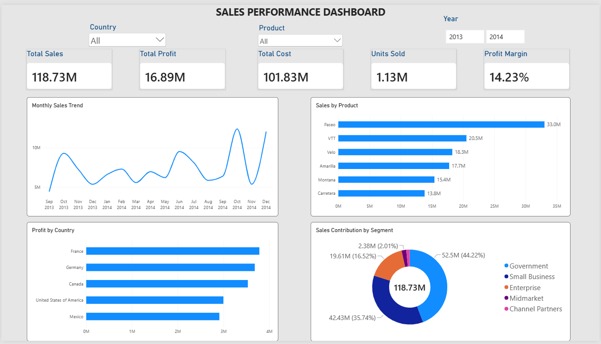

# Sales Performance Dashboard

An interactive Power BI dashboard for analyzing business sales performance and profitability.

## Tools Used
- Microsoft Power BI
- DAX
- Power Query (if used)

## Dashboard Features
- KPI cards for Total Sales, Total Profit, Total Cost, Units Sold, and Profit Margin
- Monthly sales trend analysis
- Product-wise sales comparison
- Country-wise profit analysis
- Sales contribution by business segment
- Interactive Country, Product, and Year slicers

## Key Insights
The dashboard enables users to explore sales performance, compare products, and examine profitability across countries and business segments.

## Dashboard Preview

## How to View
Download the `.pbix` file from this repository and open it in Microsoft Power BI Desktop.
